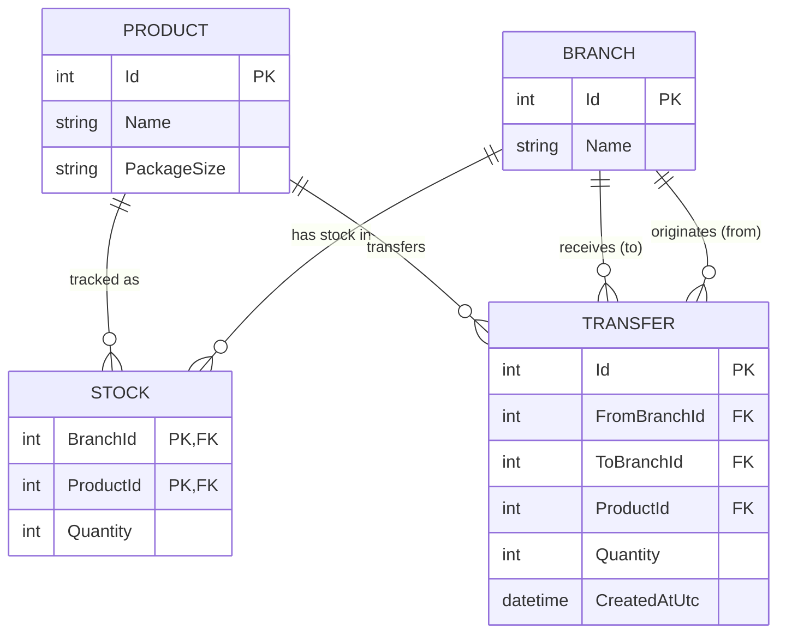

# Mihira Stock Transfer System

A full-stack stock transfer and inventory management solution built for **Mihira Stores** using an ASP.NET Core Web API backend (.NET 10), EF Core with SQLite, and a React (Vite) single-page frontend.

---

## 📖 System Overview

The **Mihira Stock Transfer System** manages retail inventory movements across multiple branch stores. It allows store managers to monitor live package quantities across retail outlets, execute immediate stock transfers between branches, and audit all completed transfer history.

### What the System Does
1. **Live Multi-Branch Stock Tracking:** Displays current whole-package inventory for five packaged products across three fixed retail branches (Colombo, Kandy, and Galle).
2. **Immediate Stock Transfers:** Transfers whole packages of a product between two branches inside an explicit database transaction. Source stock is deducted, destination stock is credited, and an audit record is saved as an atomic unit of work—ensuring total inventory across all branches is strictly conserved.
3. **Defensive Integrity & Concurrency Safeguards:** Uses conditional SQL updates (`WHERE Quantity >= requested`) and database check constraints to reject insufficient stock, negative quantities, self-transfers, and overlapping race conditions without data corruption.
4. **Audit Log:** Automatically records server-generated UTC timestamps for all completed transfers and presents them in the user interface formatted in browser-local date and time.
5. **Zero-Configuration Embedded Database:** Uses SQLite with idempotent startup seeding, creating and populating the database on first run with no separate database server required.

---

## 🗄️ Database Architecture & Entity-Relationship (ER) Diagram

The system uses Entity Framework Core with an embedded SQLite database. Inventory is modeled around three fixed branches and five packaged products, with inventory counts held in a composite join entity and completed transfers tracked in an audit entity.



### Database Constraints & Invariants
* **Composite Primary Key:** `Stock` uses `(BranchId, ProductId)` as its composite primary key to ensure one unique balance per product per branch.
* **Database Check Constraints:**
  * `CK_Stock_Quantity_NonNegative`: Enforces `Quantity >= 0` at the database engine level.
  * `CK_Transfer_Quantity_Positive`: Enforces `Quantity > 0` on all transfer records.
  * `CK_Transfer_DifferentBranches`: Enforces `FromBranchId != ToBranchId` to disallow self-transfers.
* **Restrictive Delete Actions:** Foreign keys on `Stock` and `Transfer` specify `DeleteBehavior.Restrict` to protect reference data and historical audit trails from accidental cascading deletes.

---

## 🚀 How to Run the Project Locally (Step-by-Step)

Follow these clear instructions to run both the backend and frontend locally.

### Prerequisites
* **.NET SDK:** `.NET 10.0` or compatible installed ([download .NET](https://dotnet.microsoft.com/download))
* **Node.js:** `Node.js 20+` or `22+` with `npm` installed ([download Node.js](https://nodejs.org/))

---

### Step 1: Open Two Terminal Windows
Open two separate terminal windows in the project root directory (`e:\mihira-stock-transfer`).

---

### Step 2: Start the Backend API (Terminal 1)
In the first terminal window, start the ASP.NET Core Web API:

```bash
dotnet run --project backend/MihiraStockTransfer.Api/MihiraStockTransfer.Api.csproj
```

**What happens:**
* The backend API starts on **`http://localhost:5197`** (and `https://localhost:7229`).
* On startup, `DatabaseInitializer` automatically creates `backend/MihiraStockTransfer.Api/mihira.db` if it does not already exist.
* The 3 fixed branches, 5 packaged products, and initial 15 stock balances are seeded into the database.
* Keep this terminal window open and running.

---

### Step 3: Start the Frontend Application (Terminal 2)
In the second terminal window, install dependencies and start the Vite development server:

```bash
cd frontend
npm ci
npm run dev
```

**What happens:**
* `npm ci` installs frontend dependencies cleanly from `package-lock.json`.
* The Vite development server starts on **`http://localhost:5173`**.
* The development proxy automatically rewrites all `/api/*` frontend calls to `http://localhost:5197/*`.
* Keep this terminal window open and running.

---

### Step 4: Access the User Interface
Open your web browser and navigate to:
👉 **`http://localhost:5173`**

You can now interact with the system:
1. **Inspect Branch Stock:** View package quantities for all 5 products across Colombo, Kandy, and Galle in the **Branch stock** table.
2. **Execute a Transfer:** In the **New transfer** section:
   * Select a source branch (e.g., Colombo).
   * Select a destination branch (e.g., Kandy; note Colombo is automatically disabled to prevent self-transfers).
   * Select a product (e.g., Rice; the form displays available packages and package size).
   * Enter a whole package quantity (or use the up/down steppers).
   * Click **Transfer stock**.
3. **Verify Real-Time Updates:** On confirmed transfer:
   * A success banner confirms the transfer.
   * Colombo's Rice count decreases, Kandy's increases, and total units across branches remain unchanged.
   * The **Transfer history** table immediately displays the new transfer at the top with local date and time.
4. **Test Validations:** Attempt a transfer exceeding available stock (e.g., 9999 units) to observe the clear `409 Conflict` error banner without local data corruption.

---

### Step 5: Run Automated Tests
To execute the automated integration test suite verifying transfer rules, persistence invariants, rollback guarantees, and concurrency:

```bash
dotnet test backend/MihiraStockTransfer.slnx
```

---

## 🏢 Business Reference Data

### 1. Fixed Branches
| ID | Branch Name |
| :---: | :--- |
| `1` | Colombo |
| `2` | Kandy |
| `3` | Galle |

### 2. Fixed Products
All items are stored and transferred as packaged units. Quantities represent whole-number counts of packages.

| ID | Product Name | Package Size |
| :---: | :--- | :--- |
| `1` | Rice | 1 kg bag |
| `2` | Sugar | 1 kg bag |
| `3` | Milk | 1 L carton |
| `4` | Tea | 200 g packet |
| `5` | Biscuits | 100 g packet |

### 3. Initial Stock Matrix (15 Combinations)
| Branch | Rice (1) | Sugar (2) | Milk (3) | Tea (4) | Biscuits (5) |
| :--- | :---: | :---: | :---: | :---: | :---: |
| **Colombo (1)** | 50 | 40 | 30 | 20 | 60 |
| **Kandy (2)** | 20 | 25 | 15 | 10 | 30 |
| **Galle (3)** | 15 | 20 | 20 | 15 | 25 |

---

## 📡 API Endpoints Specification

All backend endpoints use root routing (no `/api` prefix in production):

| Method | Endpoint | Description | Status Codes |
| :--- | :--- | :--- | :--- |
| `GET` | `/branches` | Returns all branches ordered by ID. | `200 OK` |
| `GET` | `/products` | Returns all products ordered by ID. | `200 OK` |
| `GET` | `/branches/{id}/stock` | Returns current stock levels for the specified branch. | `200 OK`, `404 Not Found` |
| `POST` | `/transfers` | Executes an immediate stock transfer between two branches. | `200 OK`, `400 Bad Request`, `404 Not Found`, `409 Conflict`, `503 Service Unavailable` |
| `GET` | `/transfers` | Retrieves all successful transfer records (newest first). | `200 OK` |

### Sample Request: `POST /transfers` (`200 OK`)
```json
{
  "fromBranchId": 1,
  "toBranchId": 2,
  "productId": 1,
  "quantity": 5
}
```

### Sample Response: `POST /transfers` (`200 OK`)
```json
{
  "id": 1,
  "fromBranchId": 1,
  "fromBranchName": "Colombo",
  "toBranchId": 2,
  "toBranchName": "Kandy",
  "productId": 1,
  "productName": "Rice",
  "packageSize": "1 kg bag",
  "quantity": 5,
  "createdAtUtc": "2026-10-27T15:29:08.4091612Z"
}
```

### Sample Response: `POST /transfers` (`409 Conflict`)
```json
{
  "type": "https://tools.ietf.org/html/rfc9110#section-15.5.10",
  "title": "Inventory conflict",
  "status": 409,
  "detail": "Insufficient stock for product 'Rice' at branch 'Colombo'. Available: 45, requested: 9999.",
  "traceId": "00-..."
}
```

---

## 🧪 Automated Testing & Isolation Architecture

Run the test suite:
```bash
dotnet test backend/MihiraStockTransfer.slnx
```

### Test Isolation Architecture
Integration tests execute against real SQLite file engines using the `SqliteTestDatabase` test helper:
* **Unique Ephemeral Database per Test:** Each test instance creates an isolated temporary directory in the OS temp folder with its own unique `mihira_test.db` SQLite database file.
* **No Shared State:** Tests run concurrently in parallel without colliding or accessing the application's runtime `mihira.db` database.
* **Connection Pooling Prevention:** Connection strings specify `Pooling=False` so SQLite releases file handles immediately upon context disposal, avoiding Windows file locks (`IOException`).
* **Deterministic Cleanup:** `SqliteTestDatabase` implements `IAsyncDisposable` and `IDisposable`, calling `SqliteConnection.ClearAllPools()` and recursively deleting the ephemeral directory and database file upon test completion.

### Business Guarantees Verified by the Test Suite
The automated test suite (`backend/MihiraStockTransfer.Api.Tests`) validates all core business invariants:
1. **Valid Transfer & Inventory Conservation:** Deducts exact quantity from source, adds exact quantity to destination, strictly conserves total product units across all branches, records a receipt with recent server UTC timestamps, and persists exactly one audit record.
2. **Exact Available Stock:** Transferring 100% of available stock succeeds, leaves source stock at exactly 0, credits destination, and satisfies database check constraints (`Quantity >= 0`).
3. **Insufficient Stock Protection:** Rejects transfers where requested quantity exceeds available stock with `409 Conflict`, leaving all stock levels and transfer history completely untouched.
4. **Distinct Branches:** Rejects transfers where source equals destination with `400 Bad Request`, preventing self-transfers without modifying data.
5. **Positive Quantity Enforcement:** Rejects zero and negative quantities with `400 Bad Request`, maintaining zero mutation.
6. **Referential Integrity:** Rejects nonexistent source branches, destination branches, or products with `404 Not Found`, leaving database state untouched.
7. **Inventory Safeguards:** Rejects requests when source or destination stock records are missing (`409 Conflict`), and protects against destination integer overflow (`int.MaxValue`) without data corruption.
8. **Transaction Rollback Under Partial Execution:** Uses an EF Core `SaveChangesInterceptor` (`FailingTransferSaveInterceptor`) to inject an exception during transfer record insertion *after* atomic SQL deductions (`ExecuteUpdateAsync`) have run; verifies that the entire SQLite transaction rolls back cleanly, restoring source and destination stock balances to their initial values.
9. **Concurrent Spending & Race Condition Safety:** Simulates concurrent spending with coordinated worker tasks (`Barrier`) competing for limited inventory (two concurrent requests for 8 units from 10 available units); verifies that exactly one request succeeds and one fails, source stock ends at 2 (never negative), destination is credited 8, total stock is conserved, and exactly one transfer is recorded.
10. **Transfer History Ordering & Filtering:** Confirms history is empty when no transfers exist, returns successful transfers ordered newest first (`CreatedAtUtc` descending), uses deterministic secondary sorting (`Id` descending) for equal timestamps, and proves rejected/failed attempts never appear in history.

---

## 💻 Frontend Implementation & Design Details

* **Typography (Inter):** Uses the Inter font family, bundled locally via `@fontsource/inter` (weights `400`, `500`, `600`, and `700`) without external CDN dependencies. Tabular numerals are applied to quantitative columns.
* **Palette:** Built with a white-and-navy aesthetic (`#FFFFFF`, `#142B49`), restrained borders (`#E2E8F0`), high-visibility red error banners (`#FEE2E2` bg, `#EF4444` border, `#B91C1C` text), and green success banners (`#DCFCE7` bg, `#22C55E` border, `#15803D` text).
* **Controlled Digits Stepper:** The quantity input uses `inputMode="numeric"`, accepts only ASCII digits `/^[0-9]*$/` (rejecting invalid edits and non-digit pastes), provides integrated up/down stepper buttons, and supports `ArrowUp`/`ArrowDown` keyboard navigation conforming to W3C WAI-ARIA spinbutton accessibility.
* **Development Proxy:** In development, Vite proxies `/api/*` requests to `http://localhost:5197/*` with path rewriting to prevent CORS overhead.
